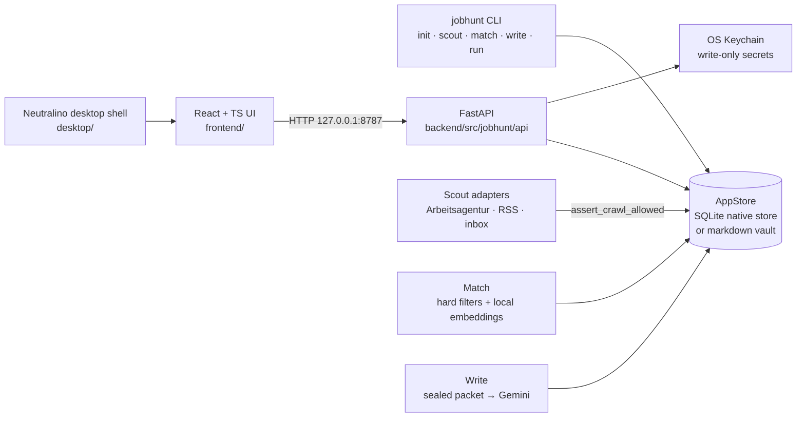

# AppFly

**Local-first job-search copilot.** AppFly scouts and matches job listings on your own machine, drafts cover letters with Gemini from a sealed evidence packet, and puts every draft in front of you for review. You approve, edit, and submit applications yourself — AppFly never applies for you.

> **Design stance:** your CV, letters, and API keys stay on your machine. The API listens on loopback only, secrets live in the OS keychain and are never returned by the API, and a hard-coded crawl deny-list (LinkedIn, Indeed, Stepstone, ZipRecruiter, Xing, Glassdoor, Wellfound) is enforced in code — those sites are never scraped or fetched, including via third-party crawlers.

## Highlights

- **End-to-end pipeline:** `scout → match → write` as CLI commands or from the UI — ingest (Arbeitsagentur API, RSS, manually clipped listings), hard-filter + local-embedding matching, then Gemini cover letters grounded in your active CV and voice samples
- **Local-first storage:** native SQLite store (`appfly.sqlite` + `files/`) under the OS app-data directory, with an optional legacy Obsidian/markdown vault backend behind a common `AppStore` interface — no cloud database, no account
- **Secrets done properly:** write-only OS-keychain storage (`backend/src/jobhunt/features/secrets/`), secret-shaped-token scanning of production UI bundles in CI, and GET endpoints that return presence flags — never values
- **Responsible automation:** the crawl deny-list is canonical in `backend/src/jobhunt/policy.py` and adapters must call `assert_crawl_allowed` first; human-in-the-loop submission is a product rule, not a limitation
- **Tested like a product:** 87 test files across backend (pytest) and frontend (Vitest + Testing Library), plus a 3-job CI pipeline (backend / frontend / desktop) with a pinned linter

## Screenshots

UI screenshots and a short walkthrough GIF are on the roadmap (see below). The UI is a dark "instrument panel" built with React + TypeScript; the fastest way to see it today is to run it locally.

## Architecture



Full details: [docs/ARCHITECTURE.md](docs/ARCHITECTURE.md) · API contract: [docs/API.md](docs/API.md) · Storage: [docs/STORAGE.md](docs/STORAGE.md) · Feature map: [docs/FEATURES.md](docs/FEATURES.md)

## Tech stack

| Layer | Technology |
|---|---|
| Backend | Python 3.12, FastAPI, SQLite (WAL), local sentence embeddings |
| Frontend | React, TypeScript, Vite, Vitest + Testing Library |
| Desktop | Neutralino shell (serves the built UI, spawns the local API) |
| AI | Gemini API for cover-letter drafting (your key, from Google AI Studio) |
| Tooling | GitHub Actions CI (3 jobs), Ruff, bundle secret scanner, launchd nightly template (macOS) |

## Setup

Python 3.12+ and Node.js 22 for the UI (`.nvmrc`; Vitest's jsdom needs Node 22, and CI uses 22). 16 GB is enough. The embedding model is ~470 MB on first `match`.

```bash
python3.12 -m venv backend/.venv
source backend/.venv/bin/activate
pip install -e "./backend[dev,extract]"   # extract = pypdf + python-docx for PDF/DOCX CVs
jobhunt init           # writes config.yaml (+ .env from .env.example) and the native store
python -m jobhunt.api  # local API on http://127.0.0.1:8787
```

The venv lives in `backend/.venv` because the nightly plist and the desktop shell start the API from there. Without the `extract` extra, PDF/DOCX uploads are stored with `extract_status: unsupported` and do not count as a CV.

Storage: the **native store is the source of truth**. `jobhunt init` sets `storage_backend: native` and creates `appfly.sqlite` plus `files/` under the app data dir: `~/Library/Application Support/AppFly/` on macOS, `~/.local/share/appfly/` on Linux. Override it with `native_data_dir` in `config.yaml` or `APPFLY_DATA_DIR`. `jobhunt init --markdown` keeps the legacy Obsidian-vault backend (`vault_path`, default `~/Documents/Job Search`). Details: [docs/STORAGE.md](docs/STORAGE.md).

Frontend:

```bash
cd frontend
nvm use               # Node 22 from .nvmrc
npm ci
npm run dev           # Vite
npm test              # Vitest + Testing Library
npm run build         # tsc + production build
npm run build:secure  # build + bundle secret scan (what CI runs)
```

Copy `frontend/.env.example` to `frontend/.env` if you need to point at the API (`VITE_API_BASE_URL=http://127.0.0.1:8787`).

Desktop shell (Neutralino, M5):

```bash
cd desktop
npm install && npm run update
npm run dev    # builds UI into resources/, opens the window, spawns API if needed
```

Details: [desktop/README.md](desktop/README.md).

Then, in the UI:

1. **Settings**: paste your Gemini key. It goes to the OS keychain and is never returned by the API. `GEMINI_API_KEY` in `.env` also works as a fallback. Get a key at [Google AI Studio](https://aistudio.google.com/apikey). The Arbeitsagentur key defaults to the public client id `jobboerse-jobsuche`.
2. **Vault**: upload your CV and 1–3 sent letters as voice samples, and mark the active CV and voice sample.
3. Adjust keywords and location in `config.yaml` (or via `PUT /settings`).

Coming from an Obsidian vault? **Settings → Import from Obsidian** (`POST /workspace/import/obsidian`) copies `Jobs/`, `Letters/`, `CV/`, `Requirements.md` and `Runs/` into the native store **once**. There is no dual-write and no live sync, so later edits in Obsidian are not picked up.

## Daily use

Start a run from the UI (`POST /runs`) or the CLI:

```bash
jobhunt scout    # fetch + inbox
jobhunt match    # filter + score (downloads the embedding model once)
jobhunt write    # Gemini letters for shortlisted jobs
jobhunt run      # scout -> match -> write in one pass
```

All four commands use the configured store (`storage_backend`: native SQLite by default, or the markdown vault).

Morning loop in the UI:

1. Open **Tonight** for the last run and the drafts waiting for review.
2. Open a job's packet and edit the letter (or regenerate it).
3. Mark it **approved** or **skipped**.
4. Submit the application yourself.
5. Set its status to `applied` (Queue status menu, or `PATCH /jobs/{source_id}`).

Clip a listing you already opened into the inbox folder: `files/inbox/` under the app data dir (`_inbox/` in markdown mode), with title, company and URL. Scout parses the local file only and will **never HTTP-fetch** a deny-listed listing URL. Do not clip search-result pages.

## Testing & CI

Run backend tests from `backend/`:

```bash
cd backend
python -m pytest
ruff check .     # classic rules from pyproject.toml; CI pins ruff 0.16.10
```

Frontend: `npm test` (Vitest) and `npm run build:secure` (production build + secret scan of the bundle). CI (`.github/workflows/ci.yml`) runs three jobs — backend, frontend, desktop — on every push/PR.

API contract: [docs/API.md](docs/API.md).

## Crawl policy (accounts)

These hosts must never be crawled, RSS-fetched, or sent to Apify. Doing so can ban your accounts:

- linkedin.com
- indeed.com (including de.indeed.com)
- stepstone.de / stepstone.com
- ziprecruiter.com
- xing.com
- glassdoor.com / glassdoor.de
- wellfound.com / angel.co

The canonical list is `backend/src/jobhunt/policy.py` (`DENIED_CRAWL_HOSTS` / `DENIED_ROOT_DOMAINS`). Inbox may **store** those URLs; nothing in this repo may fetch them.

Allowed automated ingest: Arbeitsagentur API, RSS on other hosts, public company career/Impressum pages. Future Apify actors use `sources.apify.start_urls` and are rejected if any URL is on the deny-list. Leave `apify.enabled: false` until that crawler exists.

## Layout

- `backend/` — Python package, CLI, tests, local HTTP API
- `frontend/` — Vite + React + TypeScript instrument-panel UI
- `desktop/` — Neutralino desktop shell
- `docs/` — architecture, API contract, feature ownership, workflow notes
- `vault-templates/` — templates copied by `jobhunt init` (markdown mode / import)

## Branching

GitHub Flow with a protected `main`: changes land through pull requests. While a large epic is open, related changes may stage on an `integrate/<epic>` branch and reach `main` through a single stage PR; with no epic open, branch from `main`. Full rules: [AGENTS.md](AGENTS.md).

## Nightly schedule

A launchd template lives at [launchd/com.jobhunt.nightly.plist](launchd/com.jobhunt.nightly.plist)
(weekdays **21:00**, wrapped in `caffeinate`). It points at this checkout's
`backend/.venv/bin/jobhunt run --trigger nightly`. Edit `WorkingDirectory`, the
venv path, and log paths if your machine differs. After the venv exists:

```bash
mkdir -p .cache
cp launchd/com.jobhunt.nightly.plist ~/Library/LaunchAgents/
# Edit the plist if your paths differ, then:
launchctl load ~/Library/LaunchAgents/com.jobhunt.nightly.plist
```

> [!NOTE]
> This plist is a template hard-coded to `/Users/franciskanu/Projects/AppFly` in 4 keys:
> `WorkingDirectory`, `ProgramArguments`, `StandardOutPath`, and `StandardErrorPath`.
> It is macOS-only. After editing, unload and reload with:
> ```bash
> launchctl unload ~/Library/LaunchAgents/com.jobhunt.nightly.plist
> launchctl load ~/Library/LaunchAgents/com.jobhunt.nightly.plist
> ```

Leave the lid open and the Mac plugged in if you can. `jobhunt run` is safe to re-run: existing `source_id`s are not duplicated; `draft` / `approved` / `applied` jobs are not overwritten. If another run is already active, the CLI exits **75** (busy) so launchd can tell that apart from a real failure.

## Status values

`inbox` → `shortlist` → `draft` → `approved` → `applied`, or `skipped`.

Set `gemini: false` on a job (`PATCH /jobs/{source_id}`) to keep it off the Writer.

## Limitations & roadmap

Honest current state:

- **No screenshots/demo yet** — first item on this list is capturing the UI walkthrough for this README
- **Bring-your-own Gemini key** — letter quality depends on your CV, voice samples, and the model; drafts always need human review (by design)
- **Ingest is intentionally narrow** — Arbeitsagentur, RSS, and manual clips today; deny-listed boards will never be automated (see Crawl policy)
- **Desktop shell is an MVP** (Neutralino); packaging/signing for distribution is not done
- **macOS-first** — the nightly launchd template is macOS-only; the core CLI/API/UI are cross-platform

Roadmap: UI screenshots + demo GIF · signed desktop builds · more allowed-source adapters · evaluation harness for match quality.

## Out of scope

- Computer-use or mouse apply on job boards
- Scraping LinkedIn / Indeed / Stepstone / ZipRecruiter / Xing / Glassdoor (including via Apify)
- Local 8B/14B orchestrator
- Gmail drafts (optional follow-up)

## Licence

No open-source licence has been applied to this repository yet. All rights reserved until a licence is added.
