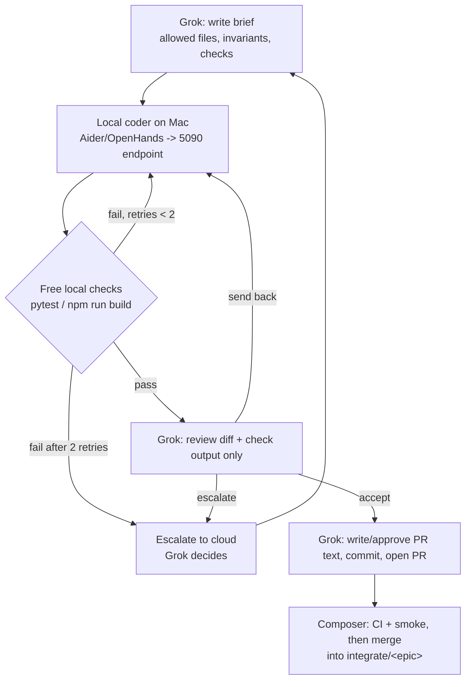

# Multi-agent operating model: one cloud planner + local-first 5090 coding

Changelog:

- 2026-09-26: switched to single cloud planner (Grok) + local-first 5090 coding.

Maintainer workflow. It is not part of the AppFly product architecture.
Product rules: [RULES.md](../../RULES.md), [AGENTS.md](../../AGENTS.md).
Role playbooks: [`docs/agents/`](../agents/README.md).
Paste-ready prompts and the brief template: [PROMPTS.md](PROMPTS.md).
Per-task token log: [TOKEN_LOG.md](TOKEN_LOG.md).

---

## 1. Goal

Cut cloud compute. One cloud planner (Grok) does the judgment. All mechanical
work goes to local models on the RTX 5090, gated by free local checks. Cloud
tokens are spent only on specs, interfaces, final review, and merge decisions.

---

## 2. Roles

| Role | Runs on | Does | Does not |
| --- | --- | --- | --- |
| **Grok** (Grokbot / Iyeke; the user's Grok Bot assistant) | Cloud | Single planner and orchestrator for backend **and** frontend. Owns epics, task breakdown, specs and interfaces, 5090 briefs, final diff review, PR text, escalation decisions. Owns the integration branch lifecycle (opens `integrate/<name>`, sequences waves). Keeps backend engine ownership. | Write bulk code or tests itself when the local coder can. Read whole files when a summary or diff is enough. |
| **Local coder** (RTX 5090 local models) | GPU host, driven from the Mac | All mechanical work from Grok's briefs: implementation (backend and frontend), unit tests and fixtures, docstrings and doc updates, first drafts of PR descriptions and commit messages, condensed file/module summaries, first-pass self-review of its own diff against the brief's invariants. | Decide architecture. Change scope. Touch files outside ALLOWED FILES. Handle secrets. Commit, push, or open PRs. |
| **Composer** (Cursor) | Cloud | Merge and CI gate. Smoke tests before merging. Desktop packaging (M5). Privacy pass (M8). | Plan. Open epics. Write specs or briefs. |
| **Claude** | Cloud, on call | UI/UX design decisions and UI review, only when Grok asks. | Act as a standing planner or own tasks. |

The product's letter LLM (`gemini_api_base`, Gemini Flash) is product runtime.
It is unrelated to this coding setup.

The 5090 is not a git branch. The local coder edits the `feat/…` branch that
is already checked out on the Mac.

---

## 3. Flow



ASCII fallback:

```text
Grok brief -> local coder (5090) -> local checks --fail(<=2 retries)--> local coder
                                          |pass                 \fail x2 -> escalate
                                          v
                             Grok reviews diff + check output
                               | accept        | send back -> local coder
                               v               | escalate  -> Grok/cloud decision
                  Grok PR text, commit, open PR
                               v
                  Composer: CI + smoke -> merge into integrate/<epic>
```

---

## 4. Loop (per task)

1. **Brief.** Grok writes a brief from the template in [PROMPTS.md](PROMPTS.md):
   allowed files, forbidden paths, condensed context, steps, invariants,
   checks, done-when, return format.
2. **Run local coder.** Grok runs the local coder on the Mac inside
   `/Users/franciskanu/Projects/AppFly`, on the task's `feat/…` branch,
   pointed at `LOCAL_LLM_BASE_URL`, restricted to the brief's ALLOWED FILES.
   Local coder auto-commits are off.
3. **Free local checks.** Run the checks in section 5 that apply to the
   touched stack.
4. **Self-fix.** If checks fail, the local coder fixes its own failures.
   Max 2 retries. Still failing after that: escalate (section 6).
5. **Review.** Grok reviews only the diff (`git diff`) plus check output and the
   local coder's self-review. Not the whole codebase. Outcome: accept, send
   back with a short correction, or escalate.
6. **PR and merge.** Grok writes or approves the PR text (the local coder may
   draft it), commits, and opens the PR into `integrate/<epic>`. Composer runs
   CI and smoke, then merges. Grok logs the task in [TOKEN_LOG.md](TOKEN_LOG.md).

---

## 5. Free local checks

Only commands that exist in the repo today are listed as required.

| Stack | Command | Status |
| --- | --- | --- |
| Backend | `cd backend && python -m pytest` | Exists (`pytest` in `[project.optional-dependencies] dev`, `[tool.pytest.ini_options]` in `backend/pyproject.toml`) |
| Backend | `ruff check .` | If/when added. No ruff config or dependency today. |
| Frontend | `cd frontend && npm run build` | Exists. Script is `tsc --noEmit && vite build`, so it already type-checks. |
| Frontend | separate `tsc --noEmit` script | Not needed; covered by `npm run build`. |
| Frontend | `npm run lint` | If/when added. No lint script or ESLint config today. |
| Frontend | `npm test` | If/when added. `frontend/src/**/*.test.*` files exist, but vitest is not a dependency and there is no `test` script, so they do not run. |

CI (`.github/workflows/ci.yml`) runs the same two gates: backend `pytest`,
frontend `npm ci` + `npm run build`.

---

## 6. Escalation to cloud (only these cases)

Work stays local unless one of these is true:

1. The local coder failed twice after retries.
2. An architecture or interface decision is needed.
3. The task is security-, privacy-, or secrets-sensitive.
4. The change spans many files across backend and frontend.

On escalation Grok decides: re-scope into smaller local briefs, write the
critical part itself, or (for UI/UX design questions) consult Claude.

---

## 7. Cloud usage principles

- Cloud is for judgment only: specs, interfaces, final review, merge decisions.
- Grok reads summaries and diffs, not full files. Ask the local coder for a
  condensed module summary before reading a large file.
- Keep briefs small and file-bounded. One brief = one concern.
- Log every task in [TOKEN_LOG.md](TOKEN_LOG.md): local vs cloud, and whether
  it escalated.

---

## 8. Git and branches

Branching rules are unchanged: see [AGENTS.md](../../AGENTS.md) and
[RULES.md](../../RULES.md).

| Who | Wave | Branch | PR into |
| --- | --- | --- | --- |
| Grok (plans), local coder (implements) | W1 backend | `feat/backend-llm-provider` | `integrate/prototype-v1` |
| Grok (plans), local coder (implements), Claude on call | W1 UI | `feat/ui-firstrun-truth` | `integrate/prototype-v1` |
| Grok (plans), local coder (implements) | W2 backend | `feat/backend-durable-runs` | `integrate/prototype-v1` |
| Grok (plans), local coder (implements), Claude on call | W2 UI | `feat/ui-run-progress` | `integrate/prototype-v1` |
| Composer | W3 | Smoke, then `integrate/prototype-v1` → `main` after human sign-off | `main` |

Epic status: `integrate/prototype-v1` exists (opened 2026-09-26 at `c5b8e95`).
From now on Grok owns the epic lifecycle: sequencing waves, announcing the base
SHA, and opening the next epic (`integrate/mvp-v1`). Composer merges.

Commits: only Grok (or the human) commits. The local coder never runs
`git commit`, `git push`, or branch commands.

---

## 9. Infrastructure (planned, not yet verified)

Status: **not set up yet.** Nothing below has been benchmarked or confirmed
end to end. First pilot task: Wave 1 `feat/backend-llm-provider`
(`gemini_api_base`).

| Item | Plan |
| --- | --- |
| GPU host | `MUC-A-3099`: RTX 5090, 32 GB VRAM |
| Serving | Ollama or vLLM (OpenAI-compatible API). TBD. |
| Coding model candidates (fit 32 GB) | Qwen2.5-Coder-32B or Qwen3-Coder-30B-A3B at 4–5-bit quant. Final choice TBD after benchmarking on AppFly tasks. |
| Summary model | A small 7–8B model. TBD. |
| Access from the Mac | Existing SSH alias `rtx5090`. It forwards local port 11434 (Ollama), 8000, 8888 and others. |
| `LOCAL_LLM_BASE_URL` | `http://127.0.0.1:11434/v1` via the tunnel (Ollama), or `http://127.0.0.1:8000/v1` (vLLM) |
| `LOCAL_LLM_MODEL` | `<TBD>` |
| Local coder tool (Mac) | Aider (default for file-bounded tasks) or OpenHands (longer tasks), pointed at `LOCAL_LLM_BASE_URL`. Not installed yet. |

Never put the GPU host's IP address in docs, briefs, or logs. Use the alias
`rtx5090`.

Template command (not verified; adjust once the stack is set up):

```bash
# Tunnel first (separate terminal): ssh rtx5090
export LOCAL_LLM_BASE_URL=http://127.0.0.1:11434/v1   # or :8000/v1 for vLLM
export LOCAL_LLM_MODEL=<TBD>
cd /Users/franciskanu/Projects/AppFly
aider --model openai/$LOCAL_LLM_MODEL \
      --openai-api-base $LOCAL_LLM_BASE_URL \
      --openai-api-key local \
      --no-auto-commits \
      <allowed files> \
      --message-file brief.md
```

Local coder commits are **off** (`--no-auto-commits`). Grok controls commits.
The `local` API key is a placeholder for the local server, not a secret.

---

## 10. Placeholders

```text
LOCAL_LLM_BASE_URL: http://127.0.0.1:11434/v1   (Ollama via rtx5090 tunnel; vLLM: :8000/v1)
LOCAL_LLM_MODEL:    <TBD>
EPIC_BASE:          integrate/prototype-v1 @ <SHA>
```
