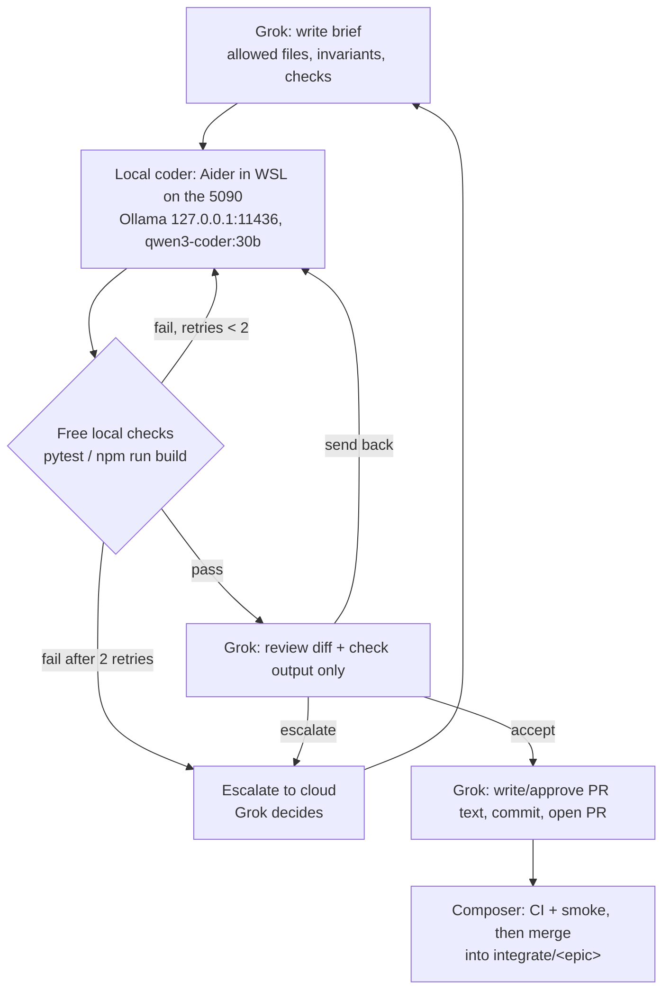

# Multi-agent operating model: one cloud planner + local-first 5090 coding

Changelog:

- 2026-09-27: §9 rewritten as the live, verified 5090 stack (Linux Ollama in WSL on
  `:11436`, Aider in WSL on the 5090, `qwen3-coder:30b`). Flow and loop text updated. The
  Mac tunnel is optional and unused.
- 2026-09-26: switched to single cloud planner (Grok) + local-first 5090 coding.

Maintainer workflow. It is not part of the AppFly product architecture.
Product rules: [RULES.md](../../RULES.md), [AGENTS.md](../../AGENTS.md).
Role playbooks: [`docs/agents/`](../agents/README.md).
Paste-ready prompts and the brief template: [PROMPTS.md](PROMPTS.md).
Per-task token log: [TOKEN_LOG.md](TOKEN_LOG.md).

---

## 1. Goal

Cut cloud compute. One cloud planner (Grok) does the judgment. All mechanical
work goes to local models on the RTX 5090, gated by free local checks. Cloud
tokens are spent only on specs, interfaces, final review, and merge decisions.

---

## 2. Roles

| Role | Runs on | Does | Does not |
| --- | --- | --- | --- |
| **Grok** (Grokbot / Iyeke; the user's Grok Bot assistant) | Cloud | Single planner and orchestrator for backend **and** frontend. Owns epics, task breakdown, specs and interfaces, 5090 briefs, final diff review, PR text, escalation decisions. Owns the integration branch lifecycle (opens `integrate/<name>`, sequences waves). Keeps backend engine ownership. | Write bulk code or tests itself when the local coder can. Read whole files when a summary or diff is enough. |
| **Local coder** (RTX 5090 local models) | 5090 host (`MUC-A-3099`), Aider in WSL, run by Grok over Shell | All mechanical work from Grok's briefs: implementation (backend and frontend), unit tests and fixtures, docstrings and doc updates, first drafts of PR descriptions and commit messages, condensed file/module summaries, first-pass self-review of its own diff against the brief's invariants. | Decide architecture. Change scope. Touch files outside ALLOWED FILES. Handle secrets. Commit, push, or open PRs. |
| **Composer** (Cursor) | Cloud | Merge and CI gate. Smoke tests before merging. Desktop packaging (M5). Privacy pass (M8). | Plan. Open epics. Write specs or briefs. |
| **Claude** | Cloud, on call | UI/UX design decisions and UI review, only when Grok asks. | Act as a standing planner or own tasks. |

The product's letter LLM (`gemini_api_base`, Gemini Flash) is product runtime.
It is unrelated to this coding setup.

The 5090 is not a git branch. The local coder edits the `feat/…` branch that
is already checked out in `~/work/AppFly` (WSL on the 5090 host).

---

## 3. Flow



ASCII fallback:

```text
Grok brief -> local coder (5090) -> local checks --fail(<=2 retries)--> local coder
                                          |pass                 \fail x2 -> escalate
                                          v
                             Grok reviews diff + check output
                               | accept        | send back -> local coder
                               v               | escalate  -> Grok/cloud decision
                  Grok PR text, commit, open PR
                               v
                  Composer: CI + smoke -> merge into integrate/<epic>
```

---

## 4. Loop (per task)

1. **Brief.** Grok writes a brief from the template in [PROMPTS.md](PROMPTS.md):
   allowed files, forbidden paths, condensed context, steps, invariants,
   checks, done-when, return format.
2. **Run local coder.** Grok runs Aider over Shell in WSL on the 5090 host,
   inside `~/work/AppFly`, on the task's `feat/…` branch, via
   `~/work/.logs/aider-run.sh` (Ollama on `127.0.0.1:11436`), restricted to the
   brief's ALLOWED FILES. Local coder auto-commits are off. See section 9.
3. **Free local checks.** Run the checks in section 5 that apply to the
   touched stack.
4. **Self-fix.** If checks fail, the local coder fixes its own failures.
   Max 2 retries. Still failing after that: escalate (section 6).
5. **Review.** Grok reviews only the diff (`git diff`) plus check output and the
   local coder's self-review. Not the whole codebase. Outcome: accept, send
   back with a short correction, or escalate.
6. **PR and merge.** Grok writes or approves the PR text (the local coder may
   draft it), commits, and opens the PR into `integrate/<epic>`. Composer runs
   CI and smoke, then merges. Grok logs the task in [TOKEN_LOG.md](TOKEN_LOG.md).

---

## 5. Free local checks

Only commands that exist in the repo today are listed as required.

| Stack | Command | Status |
| --- | --- | --- |
| Backend | `cd backend && python -m pytest` | Exists (`pytest` in `[project.optional-dependencies] dev`, `[tool.pytest.ini_options]` in `backend/pyproject.toml`) |
| Backend | `cd backend && uv run --with ruff ruff check <changed .py files>` | Local gate (waves 1–3), not in CI. No ruff config or dependency in the repo; `uv run --with ruff` fetches it for the run. Pass = no new findings compared with the base branch. |
| Any | `git diff --check` | Local gate: no whitespace errors. Aider does not strip trailing whitespace (section 9). |
| Frontend | `cd frontend && npm run build` | Exists. Script is `tsc --noEmit && vite build`, so it already type-checks. |
| Frontend | separate `tsc --noEmit` script | Not needed; covered by `npm run build`. |
| Frontend | `npm run lint` | If/when added. No lint script or ESLint config today. |
| Frontend | `npm test` | If/when added. `frontend/src/**/*.test.*` files exist, but vitest is not a dependency and there is no `test` script, so they do not run. |

CI (`.github/workflows/ci.yml`) runs the same two gates: backend `pytest`,
frontend `npm ci` + `npm run build`.

---

## 6. Escalation to cloud (only these cases)

Work stays local unless one of these is true:

1. The local coder failed twice after retries.
2. An architecture or interface decision is needed.
3. The task is security-, privacy-, or secrets-sensitive.
4. The change spans many files across backend and frontend.

On escalation Grok decides: re-scope into smaller local briefs, write the
critical part itself, or (for UI/UX design questions) consult Claude.

---

## 7. Cloud usage principles

- Cloud is for judgment only: specs, interfaces, final review, merge decisions.
- Grok reads summaries and diffs, not full files. Ask the local coder for a
  condensed module summary before reading a large file.
- Keep briefs small and file-bounded. One brief = one concern.
- Log every task in [TOKEN_LOG.md](TOKEN_LOG.md): local vs cloud, and whether
  it escalated.

---

## 8. Git and branches

Branching rules are unchanged: see [AGENTS.md](../../AGENTS.md) and
[RULES.md](../../RULES.md).

| Who | Wave | Branch | PR into |
| --- | --- | --- | --- |
| Grok (plans), local coder (implements) | W1 backend | `feat/backend-llm-provider` | `integrate/prototype-v1` |
| Grok (plans), local coder (implements), Claude on call | W1 UI | `feat/ui-firstrun-truth` | `integrate/prototype-v1` |
| Grok (plans), local coder (implements) | W2 backend | `feat/backend-durable-runs` | `integrate/prototype-v1` |
| Grok (plans), local coder (implements), Claude on call | W2 UI | `feat/ui-run-progress` | `integrate/prototype-v1` |
| Composer | W3 | Smoke, then `integrate/prototype-v1` → `main` after human sign-off | `main` |

Epic status: `integrate/prototype-v1` exists (opened 2026-09-26 at `c5b8e95`).
From now on Grok owns the epic lifecycle: sequencing waves, announcing the base
SHA, and opening the next epic (`integrate/mvp-v1`). Composer merges.

Commits: only Grok (or the human) commits. The local coder never runs
`git commit`, `git push`, or branch commands.

---

## 9. Infrastructure (live, verified 2026-09-27)

Status: **live.** Every row below was checked on the host on 2026-09-27.
Waves 1–3 of `integrate/prototype-v1` (PRs #17, #18, #19, merged 2026-09-27)
were implemented this way; backend tests went 73 → 86 → 95.

| Item | Value |
| --- | --- |
| GPU host | `MUC-A-3099` (Windows): NVIDIA GeForce RTX 5090, 32 GB VRAM |
| Runtime | WSL distro `Ubuntu-24.04` on that host. Everything below runs inside WSL. |
| Serving | Linux Ollama 0.34.4 (user-space install in `~/.local/ollama/`) on `127.0.0.1:11436`. It runs as the systemd **user** service `ollama-local.service` (enabled, `ExecStart=%h/.local/ollama/serve.sh`). `serve.sh` sets a 32768-token context, flash attention, q8_0 KV cache, 1 loaded model, 1 parallel request and a 30 min keep-alive. |
| Coding model (default) | `qwen3-coder:30b` (Q4_K_M, 18.6 GB). About 200 tok/s generation (203 tok/s in the bench, 215 tok/s in a spot check). |
| Coding model (fallback) | `qwen2.5-coder:32b` (Q4_K_M, 19.9 GB). About 65 tok/s in the bench. |
| Summary model | Not set up. |
| Local coder tool | Aider 0.86.2 (`~/.local/bin/aider`) in WSL, model `ollama_chat/qwen3-coder:30b`, `OLLAMA_API_BASE=http://127.0.0.1:11436`. OpenHands is not installed. |
| Driver | Grok runs Aider over Shell on the host (`wsl -d Ubuntu-24.04`). The Mac is not in the loop. |
| Checkout | `~/work/AppFly` in WSL (remote `git@github.com:FOKanu/AppFly.git`) |
| Wrapper | `~/work/.logs/aider-run.sh` (safe flags, see below) |
| Briefs and logs | `~/work/.logs/` (`brief-*.md`, `aider-*.log`; later waves in `w2/`, `w3/`) |
| Node | nvm, Node 24 (`nvm use 24`), for `npm run build` |
| Push and PRs | `git push` over SSH as `FOKanu`. PRs are opened through the GitHub connector (`gh` is not logged in). |

Caveats:

- **Windows Ollama shares the GPU.** A Windows Ollama (also 0.34.4) listens on
  `:11434` on the same host and is reachable from WSL. It shares the same
  32 GB VRAM. If a model loads slowly or spills to CPU, check `nvidia-smi` for
  a model held by the Windows instance. Point Aider at `:11436`, never `:11434`.
- **Mac tunnel (optional, unused).** The SSH aliases `rtx5090` / `rtx5090-llm`
  forward local port 11434 from the Mac. Nothing in the current loop uses them,
  and they were not re-verified on 2026-09-27.

Never put the GPU host's IP address in docs, briefs, or logs. Use the host
name `MUC-A-3099` or the alias `rtx5090`.

Run (as used for waves 1–3; in WSL on `MUC-A-3099`):

```bash
cd ~/work/AppFly && git switch feat/<task>        # Grok creates the branch
# FILES = the brief's ALLOWED FILES (the only files Aider may edit)
FILES="backend/src/jobhunt/<module>.py backend/tests/test_<module>.py" \
  setsid nohup bash ~/work/.logs/aider-run.sh 1 ~/work/.logs/brief-<task>.md \
  > ~/work/.logs/aider-<task>-try1.log 2>&1 < /dev/null &
# Done when the log ends with AIDER_EXIT=<code>. Then run the gates.
```

What `aider-run.sh <try#> <brief>` runs:

```bash
export OLLAMA_API_BASE=http://127.0.0.1:11436
cd ~/work/AppFly
timeout 1500 aider --model ollama_chat/qwen3-coder:30b \
  --edit-format diff --map-tokens 1024 \
  --no-auto-commits --no-dirty-commits --yes-always \
  --no-detect-urls --no-suggest-shell-commands \
  --no-pretty --no-stream --no-show-release-notes \
  ${CONF_READ---read backend/tests/conftest.py} ${READS:-} $FILES \
  --message-file "$2" < /dev/null
echo "AIDER_EXIT=$?"
```

- `FILES`: editable files. Always set it; the script's built-in default is the
  wave-1 file list. `READS`: extra `--read <file>` context.
- `CONF_READ`: defaults to `--read backend/tests/conftest.py`. Set `CONF_READ=`
  to drop it (for example on frontend-only briefs).
- The model is fixed in the wrapper. To use the fallback, run the same command
  with `--model ollama_chat/qwen2.5-coder:32b`.

Gates after each try (from `~/work/AppFly`):

```bash
(cd backend && uv run python -m pytest -q)
(cd backend && uv run --with ruff ruff check <changed .py files>)   # no new findings vs base
git diff --check
(cd frontend && . ~/.nvm/nvm.sh && nvm use 24 && npm run build)
```

Lessons from waves 1–3:

- Aider does not reliably strip trailing whitespace. Fix it with
  `sed -i 's/[ \t]*$//' <file>` and re-run `git diff --check`.
- Briefs that quote markdown verbatim need explicit SEARCH/REPLACE blocks.
- Files that are only mentioned in the brief's text can have their edits
  dropped. Pass every file to edit via `FILES`.
- Keep briefs ASCII when they go through the PowerShell → WSL pipe; other
  characters arrive as `?`.

Local coder commits are **off** (`--no-auto-commits --no-dirty-commits`).
Grok controls commits.

---

## 10. Placeholders

```text
OLLAMA_API_BASE:  http://127.0.0.1:11436        (Linux Ollama in WSL; :11434 is Windows Ollama)
AIDER_MODEL:      ollama_chat/qwen3-coder:30b   (fallback: ollama_chat/qwen2.5-coder:32b)
REPO:             ~/work/AppFly                 (WSL Ubuntu-24.04 on MUC-A-3099)
EPIC_BASE:        integrate/prototype-v1 @ <SHA>
```

Older briefs call the first two `LOCAL_LLM_BASE_URL` and `LOCAL_LLM_MODEL`.
