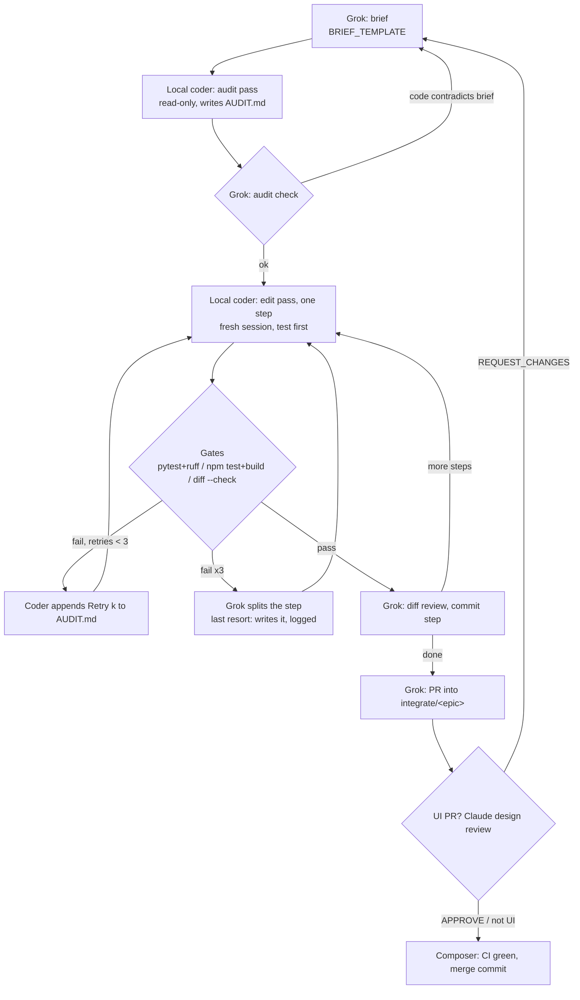

# Multi-agent operating model: one cloud planner + local-first 5090 coding

Changelog:

- 2026-10-03: **Local-coder workflow v2** (user-mandated): brief -> coder audit pass (read-only
  AUDIT.md) -> Grok audit check -> edit pass per step (tests first, fresh session) -> gates;
  max 3 retries per step, coder updates AUDIT.md first. Roles: Grok = plan/brief/audit-check/diff
  review; local coder = audit + implementation; Composer = gates/merge; Claude = UI review.
  Driver moved to the Mac (Aider + SSH tunnel to the 5090); `num_ctx` 32768, audit budget ~19k.
  Details: [LOCAL_CODER.md](../agents/LOCAL_CODER.md), [BRIEF_TEMPLATE.md](../agents/BRIEF_TEMPLATE.md).
- 2026-09-27: §4a — local bulk slices + mandatory cloud check-ins (M2 Aider lesson:
  9-file `diff` → 0 applies; `whole` → runaway). See LOCAL_BULK_LESSONS.md and
  `.cursor/rules/local-coder-bulk.mdc`.
- 2026-09-27: §1a — compute modes. **Default** stays the current mixed split. **Optimized**
  (~75% local implementation) is an optional user choice and the fallback when cloud
  agents are about to hit the user's token / credit limits. Roles and loop unchanged.
- 2026-09-27: §9 rewritten as the live, verified 5090 stack (Linux Ollama in WSL on
  `:11436`, Aider in WSL on the 5090, `qwen3-coder:30b`). Flow and loop text updated. The
  Mac tunnel is optional and unused.
- 2026-09-26: switched to single cloud planner (Grok) + local-first 5090 coding.

Maintainer workflow. It is not part of the AppFly product architecture.
Product rules: [RULES.md](../../RULES.md), [AGENTS.md](../../AGENTS.md).
Role playbooks: [`docs/agents/`](../agents/README.md).
Paste-ready prompts: [PROMPTS.md](PROMPTS.md). Brief template: [BRIEF_TEMPLATE.md](../agents/BRIEF_TEMPLATE.md).
Per-task token log: [TOKEN_LOG.md](TOKEN_LOG.md).

---

## 1. Goal

One cloud planner (Grok) owns judgment: specs, interfaces, briefs, final review,
PR text, and merge handoff to Composer. The RTX 5090 local coder can take mechanical
implementation, gated by free local checks.

**Default for now:** keep the **current** compute split (section 1a). Do not force
every edit through the 5090. Cloud may still implement when that is how the wave
is running (Grok credits out, Cursor temp orchestrator, small Composer fixes, etc.).

**Optional / fallback:** the **optimized** local-heavy split (section 1a) when the
user chooses it, or when a cloud agent is about to exhaust the user's tokens or
plan credits.

---

## 1a. Compute modes (default vs optimized)

Shares are **approximate compute units** (tokens × model weight), not lines of code.
Log which mode you used in [TOKEN_LOG.md](TOKEN_LOG.md).

| Mode | When to use | Local coder | Cloud planner / review | Composer gate | Claude on call |
| --- | --- | --- | --- | --- | --- |
| **Default (current)** | Normal operation until the human opts in to optimized | ~40–55% when briefed; skippable | ~45–60% (plan, review, and often implement) | ~5–8% | ~0–3% |
| **Optimized** | User opts in, **or** cloud is about to hit token / credit limits | **~70–80%** of implementation | **~12–18%** judgment only (briefs + diff review + PR text) | ~5–8% | ~0–3% |

### Default (current) — stay on this unless told otherwise

- Roles and the per-task loop in sections 2–4 still apply when the 5090 is used.
- Cloud agents may write code, tests, and docs directly when that matches how the
  wave is already running. Prefer local for large mechanical batches when the 5090
  is reachable, but do not block the wave on a local-only rule.
- Composer remains merge / CI / smoke. Claude stays on call for UI design.

### Optimized — optional, and token-limit fallback

Target roughly **3:1 to 4:1 local:cloud** on coding waves.

**User option:** the human asks to run in optimized mode for a wave or epic.

**Automatic fallback:** a cloud planner, temp orchestrator (Cursor), or Composer
**must** switch into optimized mode when it can see that the next cloud
implementation pass would exhaust or nearly exhaust the user's remaining tokens,
Grok Bot credits, or Cursor plan quota. Then:

1. Stop writing bulk code in the cloud. Finish only the brief (or a smaller re-scope).
2. Hand implementation to the 5090 via [PROMPTS.md](PROMPTS.md) (ALLOWED FILES,
   invariants, concrete acceptance checks).
3. Review only `git diff` + local check output. Max 2 local retries, then escalate
   with a smaller brief — do not burn the last cloud tokens re-implementing.
4. Note `mode=optimized (token-limit fallback)` in TOKEN_LOG for that task.

Safety under optimized mode is **brief quality + gates**, not model trust: file-bounded
ALLOWED FILES, named acceptance checks, local pytest / `npm run build`, cloud
diff review, Composer smoke. Never send crawl-policy, Keychain/secrets, or
deny-list exceptions to a vague local brief.

---

## 2. Roles

| Role | Runs on | Does | Does not |
| --- | --- | --- | --- |
| **Grok** (Grokbot / Iyeke; the user's Grok Bot assistant) | Cloud | **Plan, brief, audit check, diff review.** Epics and the integration branch lifecycle, task breakdown, specs and interfaces, briefs ([BRIEF_TEMPLATE.md](../agents/BRIEF_TEMPLATE.md)), checking AUDIT.md, final diff review, PR text, commits, escalation. | Write code itself, except as a logged last resort. Read whole files when AUDIT.md or a diff is enough. |
| **Local coder** (RTX 5090 local models) | Ollama on `MUC-A-3099`; Aider driven by Grok (Mac + SSH tunnel, or WSL) | **Audit pass + implementation.** Read-only audit (AUDIT.md: answers, current behaviour, exact lines, callers/tests, first test, contradictions), then one edit pass per step: test first, then code, self-gate. | Decide architecture. Change scope. Edit files outside the step. Handle secrets. Commit, push, or open PRs. |
| **Composer** (Cursor) | Cloud | **Gates and merges.** Local + CI gates, smoke tests, merge commits. Desktop packaging (M5). Privacy pass (M8). | Plan. Open epics. Write specs or briefs. |
| **Claude** | Cloud, on call | **UI review.** Design review of every UI PR (`VERDICT: APPROVE` / `REQUEST_CHANGES` with specifics); UI/UX design calls when Grok asks. | Act as a standing planner or own tasks. |

The product's letter LLM (`gemini_api_base`, Gemini Flash) is product runtime.
It is unrelated to this coding setup.

The 5090 is not a git branch. The local coder edits the `feat/…` branch that
Grok checked out in the driver's worktree (today `~/Projects/AppFly-gaps` on the Mac).

---

## 3. Flow



ASCII fallback:

```text
Grok brief -> coder audit (AUDIT.md) -> Grok audit check --contradiction--> rewrite brief
                                              | ok
                                              v
            coder edit pass (one step, test first) -> gates --fail(<=3, AUDIT.md first)--> coder
                                              | pass                 \fail x3 -> split step
                                              v
                         Grok diff review + commit step (repeat per step)
                                              v
                Grok PR -> Claude review (UI PRs) -> Composer: CI green -> merge commit
```

---

## 4. Loop (per task)

**Superseded on 2026-10-03 by workflow v2** — the authoritative loop is
[LOCAL_CODER.md §2](../agents/LOCAL_CODER.md) (brief -> audit -> audit check -> edit passes ->
gates -> retries). The text below is the earlier loop, kept for history.

1. **Brief.** Grok writes a brief from the template in [PROMPTS.md](PROMPTS.md):
   allowed files, forbidden paths, condensed context, steps, invariants,
   checks, done-when, return format.
2. **Run local coder.** Grok runs Aider over Shell in WSL on the 5090 host,
   inside `~/work/AppFly`, on the task's `feat/…` branch, via
   `~/work/.logs/aider-run.sh` (Ollama on `127.0.0.1:11436`), restricted to the
   brief's ALLOWED FILES. Local coder auto-commits are off. See section 9.
3. **Free local checks.** Run the checks in section 5 that apply to the
   touched stack.
4. **Self-fix.** If checks fail, the local coder fixes its own failures.
   Max 2 retries. Still failing after that: escalate (section 6).
5. **Review.** Grok reviews only the diff (`git diff`) plus check output and the
   local coder's self-review. Not the whole codebase. Outcome: accept, send
   back with a short correction, or escalate.
6. **PR and merge.** Grok writes or approves the PR text (the local coder may
   draft it), commits, and opens the PR into `integrate/<epic>`. Composer runs
   CI and smoke, then merges. Grok logs the task in [TOKEN_LOG.md](TOKEN_LOG.md).

---

## 4a. Local bulk packages and cloud check-ins

Pinned Cursor rule: [`.cursor/rules/local-coder-bulk.mdc`](../../.cursor/rules/local-coder-bulk.mdc).
Evidence (M2): [LOCAL_BULK_LESSONS.md](LOCAL_BULK_LESSONS.md).

Under **default** (mixed) mode especially, do **not** send a cross-stack feature to
the 5090 as one Aider package (many ALLOWED FILES + large modules). Local models
fail in two common ways: SEARCH/REPLACE that never applies (`diff`), or runaway
whole-file generation (`whole`).

**Required pattern:**

1. **Slice** the task into sequential briefs (about ≤4–6 files each; often fewer).
2. After each slice, **check in with cloud** before the next: `git diff --stat`,
   Applied-edit count, pytest if ready, and the local RETURN (questions, method
   flags, tech-stack doubts). Cloud answers those before the next brief.
3. Prefer Aider **`diff`**. Use **`whole` only for one small new file**, never for
   multi-module rewrites.
4. On **0 Applied edits** or runaway `n_gen`: kill, escalate, **shrink** — do not
   relaunch a larger package.

Briefs that must stay multi-file should still list **CHECK-IN AFTER** steps
(e.g. after schema+route, after pipeline thread, before docs) so the orchestrator
stops and reviews even if Aider is still running a series of small passes.

---

## 5. Free local checks

Only commands that exist in the repo today are listed as required.

| Stack | Command | Status |
| --- | --- | --- |
| Backend | `cd backend && python -m pytest` | Exists (`pytest` in `[project.optional-dependencies] dev`, `[tool.pytest.ini_options]` in `backend/pyproject.toml`) |
| Backend | `cd backend && ruff check .` (ruff **0.16.10**) | In CI since #68 (`pip install ruff==0.16.10`; rules from `[tool.ruff]` in `backend/pyproject.toml`). Pin the same version locally. |
| Any | `git diff --check` | Local gate: no whitespace errors. Aider does not strip trailing whitespace (section 9). |
| Frontend | `cd frontend && npm run build` | Exists. Script is `tsc --noEmit && vite build`, so it already type-checks. |
| Frontend | separate `tsc --noEmit` script | Not needed; covered by `npm run build`. |
| Frontend | `npm run lint` | If/when added. No lint script or ESLint config today. |
| Frontend | `npm test` | Exists (`vitest run`). Wired in F3; CI runs it before `npm run build`. |

CI (`.github/workflows/ci.yml`) runs Backend (ruff 0.16.10 + pytest with `[extract]`), Frontend
(`npm ci`, `npm test`, `npm run build:secure`, Node 22) and Desktop (`prepare-resources`).

---

## 6. Escalation to cloud (only these cases)

Work stays local unless one of these is true:

1. The local coder failed twice after retries.
2. An architecture or interface decision is needed.
3. The task is security-, privacy-, or secrets-sensitive.
4. The change spans many files across backend and frontend.

On escalation Grok decides: re-scope into smaller local briefs, write the
critical part itself, or (for UI/UX design questions) consult Claude.

---

## 7. Cloud usage principles

- Under **optimized** mode (section 1a): cloud is for judgment only — specs,
  interfaces, final review, merge decisions. Under **default** mode, cloud may
  also implement; prefer local for large mechanical batches when the 5090 is up.
- Grok reads summaries and diffs, not full files. Ask the local coder for a
  condensed module summary before reading a large file when the 5090 is in use.
- Keep briefs small and file-bounded. One brief = one concern. **Slice** cross-stack
  work; mandatory cloud check-in between local slices ([§4a](MULTI_AGENT.md#4a-local-bulk-packages-and-cloud-check-ins)).
- Log every task in [TOKEN_LOG.md](TOKEN_LOG.md): mode (`default` / `optimized`),
  local vs cloud, and whether it escalated or fell back for token limits.
- If about to hit user token / credit limits, switch to **optimized** (section 1a)
  instead of continuing a large cloud coding pass.

---

## 8. Git and branches

Branching rules are unchanged: see [AGENTS.md](../../AGENTS.md) and
[RULES.md](../../RULES.md).

| Who | Wave | Branch | PR into |
| --- | --- | --- | --- |
| Grok (plans), local coder (implements) | W1 backend | `feat/backend-llm-provider` | `integrate/prototype-v1` |
| Grok (plans), local coder (implements), Claude on call | W1 UI | `feat/ui-firstrun-truth` | `integrate/prototype-v1` |
| Grok (plans), local coder (implements) | W2 backend | `feat/backend-durable-runs` | `integrate/prototype-v1` |
| Grok (plans), local coder (implements), Claude on call | W2 UI | `feat/ui-run-progress` | `integrate/prototype-v1` |
| Composer | W3 | Smoke, then `integrate/prototype-v1` → `main` after human sign-off | `main` |

Epic status: `integrate/prototype-v1` exists (opened 2026-09-26 at `c5b8e95`).
From now on Grok owns the epic lifecycle: sequencing waves, announcing the base
SHA, and opening the next epic (`integrate/mvp-v1`). Composer merges.

Commits: only Grok (or the human) commits. The local coder never runs
`git commit`, `git push`, or branch commands.

---

## 9. Infrastructure (verified 2026-09-27; driver updated 2026-10-03)

**Current driver (2026-10-03):** Aider runs on the Mac (`~/Projects/AppFly-gaps`) against the
5090's Ollama through `ssh -f -N -L 11436:127.0.0.1:11436 rtx5090`. Effective `num_ctx` 32768
(`OLLAMA_CONTEXT_LENGTH=32768` on `ollama-local.service`, and Aider's model settings), audit
budget ~19k tokens. Commands and scripts: [LOCAL_CODER.md](../agents/LOCAL_CODER.md) §1 and §3.
The WSL driver below still works and is the fallback when the Mac is not available.

Status: **live.** Every row below was checked on the host on 2026-09-27.
Waves 1–3 of `integrate/prototype-v1` (PRs #17, #18, #19, merged 2026-09-27)
were implemented this way; backend tests went 73 → 86 → 95.

| Item | Value |
| --- | --- |
| GPU host | `MUC-A-3099` (Windows): NVIDIA GeForce RTX 5090, 32 GB VRAM |
| Runtime | WSL distro `Ubuntu-24.04` on that host. Everything below runs inside WSL. |
| Serving | Linux Ollama 0.34.4 (user-space install in `~/.local/ollama/`) on `127.0.0.1:11436`. It runs as the systemd **user** service `ollama-local.service` (enabled, `ExecStart=%h/.local/ollama/serve.sh`). `serve.sh` sets a 32768-token context, flash attention, q8_0 KV cache, 1 loaded model, 1 parallel request and a 30 min keep-alive. |
| Coding model (default) | `qwen3-coder:30b` (Q4_K_M, 18.6 GB). About 200 tok/s generation (203 tok/s in the bench, 215 tok/s in a spot check). |
| Coding model (fallback) | `qwen2.5-coder:32b` (Q4_K_M, 19.9 GB). About 65 tok/s in the bench. |
| Summary model | Not set up. |
| Local coder tool | Aider 0.86.2 (`~/.local/bin/aider`) in WSL, model `ollama_chat/qwen3-coder:30b`, `OLLAMA_API_BASE=http://127.0.0.1:11436`. OpenHands is not installed. |
| Driver | Grok runs Aider over Shell on the host (`wsl -d Ubuntu-24.04`). The Mac is not in the loop. |
| Checkout | `~/work/AppFly` in WSL (remote `git@github.com:FOKanu/AppFly.git`) |
| Wrapper | `~/work/.logs/aider-run.sh` (safe flags, see below) |
| Briefs and logs | `~/work/.logs/` (`brief-*.md`, `aider-*.log`; later waves in `w2/`, `w3/`) |
| Node | nvm, Node 24 (`nvm use 24`), for `npm run build` |
| Push and PRs | `git push` over SSH as `FOKanu`. PRs are opened through the GitHub connector (`gh` is not logged in). |

Caveats:

- **Windows Ollama shares the GPU.** A Windows Ollama (also 0.34.4) listens on
  `:11434` on the same host and is reachable from WSL. It shares the same
  32 GB VRAM. If a model loads slowly or spills to CPU, check `nvidia-smi` for
  a model held by the Windows instance. Point Aider at `:11436`, never `:11434`.
- **Mac tunnel (optional, unused).** The SSH aliases `rtx5090` / `rtx5090-llm`
  forward local port 11434 from the Mac. Nothing in the current loop uses them,
  and they were not re-verified on 2026-09-27.

Never put the GPU host's IP address in docs, briefs, or logs. Use the host
name `MUC-A-3099` or the alias `rtx5090`.

Run (as used for waves 1–3; in WSL on `MUC-A-3099`):

```bash
cd ~/work/AppFly && git switch feat/<task>        # Grok creates the branch
# FILES = the brief's ALLOWED FILES (the only files Aider may edit)
FILES="backend/src/jobhunt/<module>.py backend/tests/test_<module>.py" \
  setsid nohup bash ~/work/.logs/aider-run.sh 1 ~/work/.logs/brief-<task>.md \
  > ~/work/.logs/aider-<task>-try1.log 2>&1 < /dev/null &
# Done when the log ends with AIDER_EXIT=<code>. Then run the gates.
```

What `aider-run.sh <try#> <brief>` runs:

```bash
export OLLAMA_API_BASE=http://127.0.0.1:11436
cd ~/work/AppFly
timeout 1500 aider --model ollama_chat/qwen3-coder:30b \
  --edit-format diff --map-tokens 1024 \
  --no-auto-commits --no-dirty-commits --yes-always \
  --no-detect-urls --no-suggest-shell-commands \
  --no-pretty --no-stream --no-show-release-notes \
  ${CONF_READ---read backend/tests/conftest.py} ${READS:-} $FILES \
  --message-file "$2" < /dev/null
echo "AIDER_EXIT=$?"
```

- `FILES`: editable files. Always set it; the script's built-in default is the
  wave-1 file list. `READS`: extra `--read <file>` context.
- `CONF_READ`: defaults to `--read backend/tests/conftest.py`. Set `CONF_READ=`
  to drop it (for example on frontend-only briefs).
- The model is fixed in the wrapper. To use the fallback, run the same command
  with `--model ollama_chat/qwen2.5-coder:32b`.

Gates after each try (from `~/work/AppFly`):

```bash
(cd backend && uv run python -m pytest -q)
(cd backend && uv run --with ruff ruff check <changed .py files>)   # no new findings vs base
git diff --check
(cd frontend && . ~/.nvm/nvm.sh && nvm use 24 && npm run build)
```

Lessons from waves 1–3:

- Aider does not reliably strip trailing whitespace. Fix it with
  `sed -i 's/[ \t]*$//' <file>` and re-run `git diff --check`.
- Briefs that quote markdown verbatim need explicit SEARCH/REPLACE blocks.
- Files that are only mentioned in the brief's text can have their edits
  dropped. Pass every file to edit via `FILES`.
- Keep briefs ASCII when they go through the PowerShell → WSL pipe; other
  characters arrive as `?`.

Local coder commits are **off** (`--no-auto-commits --no-dirty-commits`).
Grok controls commits.

---

## 10. Placeholders

```text
OLLAMA_API_BASE:  http://127.0.0.1:11436        (Linux Ollama in WSL; :11434 is Windows Ollama)
AIDER_MODEL:      ollama_chat/qwen3-coder:30b   (fallback: ollama_chat/qwen2.5-coder:32b)
REPO:             ~/work/AppFly                 (WSL Ubuntu-24.04 on MUC-A-3099)
EPIC_BASE:        integrate/prototype-v1 @ <SHA>
```

Older briefs call the first two `LOCAL_LLM_BASE_URL` and `LOCAL_LLM_MODEL`.
